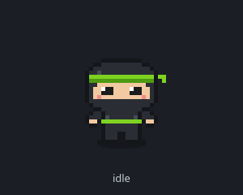
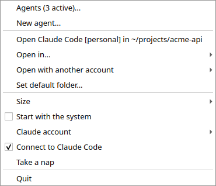
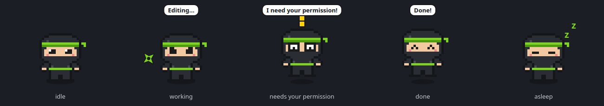
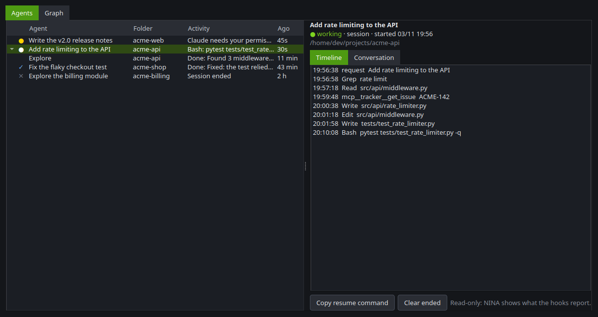
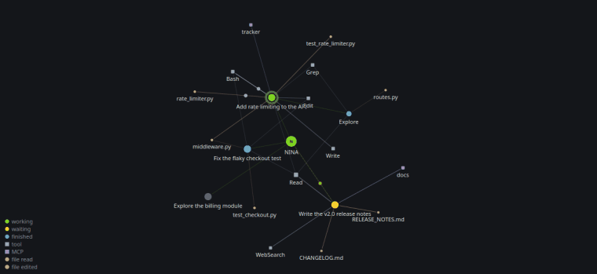
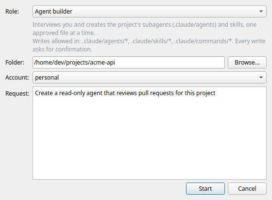
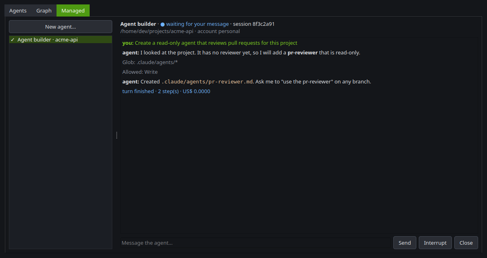
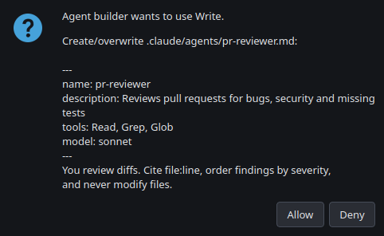

# NINA

**English** · [Português (Brasil)](README.pt-BR.md)

A tiny pixel-art ninja that lives on your desktop and makes your AI coding agents **visible and controllable**.
Click her to open [Claude Code](https://docs.claude.com/en/docs/claude-code) in a terminal; leave her running and she shows what your agents are doing.

> NINA is an independent project, not affiliated with or endorsed by Anthropic. "Claude" and "Claude Code" are trademarks of Anthropic.

<p align="center"></p>

## What it does

- **Opens Claude Code with one click**: in a default folder, a recent one, or any folder, on any of your Claude accounts.
- **Reacts to what Claude is doing** (through Claude Code hooks): a focused look and a spinning shuriken while it works, a short bubble with the current activity ("Editing...", "Running a command..."), wide eyes with a pinned bubble when it needs your permission, and a celebration when it is done. With several sessions open, waiting beats working beats idle.
- **Agents panel**: every Claude Code session and subagent as a tree, with its state, last action, timeline and conversation.
- **Agent graph**: an Obsidian-style live graph of sessions, subagents, tools, MCP servers and files, with pulses showing the data flow as events happen, and a timeline **replay**.
- **Agents on any AI**: each role (developer, writing reviewer...) can run on Claude or on any OpenAI-compatible API (OpenAI, Gemini, Ollama, OpenRouter...), with the same tools and the same safety.
- **Managed agents** (optional): launch agents by *role*, chat with them, interrupt them, resume them after a restart, and approve every risky action in a dialog. Includes an **agent builder** that interviews you and writes project subagents and skills, one approved file at a time.
- **Plugins**: small local Python files can add alerts and menu items (see below).
- English UI with a complete Brazilian Portuguese translation (`"language": "pt-BR"`); new languages are a single catalog file.

## Requirements

- Linux with X11 or XWayland (Ubuntu/GNOME works; NINA forces the `xcb` Qt platform so she can stay on top), or Windows 10/11. macOS is not supported yet.
- Python 3.10+ and [Claude Code](https://docs.claude.com/en/docs/claude-code) (`claude` in your `PATH`).

## Install

```bash
git clone https://github.com/RafaelDMachado2001/nina.git
cd nina
./scripts/install-ubuntu.sh            # Ubuntu/Debian: system libraries, virtualenv, menu entry
# ./scripts/install-ubuntu.sh agents   # ...plus managed agents (bundles the Claude Code CLI, ~300 MB)
```

Or, on any distribution, in a virtual environment: `pip install -e .` (add `[agents]` for managed agents; `[dev]` for the linter).
You will need the Qt xcb libraries (on Ubuntu: `libxcb-cursor0 libxkbcommon-x11-0`).

Start it with `nina`, then right click the mascot and enable **Connect to Claude Code** (or run `nina --install-hooks`).
It merges NINA's hooks into the active account's `settings.json`: it never overwrites anything, keeps a timestamped backup, is idempotent,
and `nina --uninstall-hooks` removes only NINA's entries. Start a new `claude` session afterwards (`/hooks` lists what is loaded).

### Windows

```powershell
git clone https://github.com/RafaelDMachado2001/nina.git
cd nina
powershell -ExecutionPolicy Bypass -File scripts\install-windows.ps1 -Agents -Hooks -Shortcut -Start
```

It creates `.venv`, installs NINA (`-Agents` adds managed agents and the chat), adds **NINA** to the Start Menu and, with the
optional switches, connects her to Claude Code (`-Hooks`), adds the `Ctrl+Alt+N` global shortcut (`-Shortcut`), starts her with
Windows (`-Autostart`) and starts her now (`-Start`). She runs under `pythonw.exe`, so no console window stays open.
On Windows:

- The control channel is a per-user named pipe (`\\.\pipe\nina-<user>`) instead of a Unix socket; the hook is registered as
  `pythonw.exe -m nina.hook`, so no console flashes on each tool call.
- **Open Claude Code** opens a Windows Terminal tab (or a PowerShell console when `wt` is missing; `"terminal": "pwsh"` or `"powershell"` in
  `config.json` forces one) and sets `CLAUDE_CONFIG_DIR` for the chosen account there.
- **Start with the system** writes a value in `HKCU\Software\Microsoft\Windows\CurrentVersion\Run`.
- The global shortcut is a Start Menu shortcut (`NINA Chat`) with a hotkey that Windows itself listens for. Windows only accepts
  combinations with `Ctrl` and/or `Alt` (no `Win` key): `nina --install-shortcut "Ctrl+Shift+N"` picks another one.
- Configuration and state live in the same places as on Linux, under your profile: `%USERPROFILE%\.config
ina` and
  `%USERPROFILE%\.local\state
ina`.

## Use

| Action | Result |
|---|---|
| Click | Only dismisses a waiting alert; with the `agents` extra it opens nothing (without it, a click opens Claude Code in the default folder) |
| Double click | Opens the chat window beside her (needs the `agents` extra); the terminal stays one right click away |
| Drag | Moves her (the position is remembered) |
| Right click | Agents panel, new agent, open elsewhere / with another account, size, start with the system, connect to Claude Code, nap, quit |



She falls asleep after 10 idle minutes. From a terminal: `nina say "text"`, `nina happy`, `nina show`, `nina sleep`, `nina chat`, `nina open`, `nina ask "text"` talk to the running instance.

### Mascot states



| Claude Code event | Reaction |
|---|---|
| `UserPromptSubmit` | working: focused look, spinning shuriken |
| `PreToolUse` | still working; a short bubble when the tool changes (Editing, Running a command, Reading, Searching) |
| `Notification` | waiting: wide eyes, yellow "!", pinned bubble ("I need your permission!" or "I'm waiting for you!") |
| `PostToolUse` | an approved tool finished: back to working |
| `Stop` | done: celebration |
| `SessionEnd` | back to normal |

If a session stays "working" for 3 minutes without events (for example after you pressed Esc), she goes back to normal.

### Agents panel and graph

Right click → **Agents**. The **Agents** tab lists sessions with their subagents; select one to see its timeline and its conversation (read from the
transcript Claude Code keeps on disk). The **Graph** tab draws NINA at the center and, around her, sessions, the subagents they spawned, the tools
and MCP servers they called and the files they read (tan) or edited (light): edge thickness is how many times it was used and old edges fade.
**Live** shows each event as a pulse along the edges; untick it for the **replay** timeline. Drag nodes, scroll to zoom, double click to frame everything.





Only what the hooks report is shown: delegation from a session to its subagents, tools, MCP servers and files. Independent sessions do **not** talk to
each other. Events are stored locally in SQLite (`~/.local/state/nina/agents.db`, 7 days), and common secrets (tokens, passwords, keys) are masked before storing or showing.
The transcript format is not documented by Claude Code and may change between versions, so it only enriches the screen; the state always comes from the hooks.

### Managed agents (optional)

Install the extra (`pip install -e ".[agents]"`), then right click → **New agent...** (or the panel's **Managed** tab).
Pick a **role**, a folder, an account and what you want done.



The agent runs through the
[Claude Agent SDK](https://code.claude.com/docs/en/agent-sdk/overview), using your installed `claude`, on the account you chose.

**Safety:** nothing happens without you. Reads (`Read`, `Glob`, `Grep`) are pre-approved; everything else asks **Allow / Deny** with exactly what will run
(the file and its content, or the shell command). A write outside the role's paths is denied without even asking, and read-only roles have `Write`/`Edit`
disabled in the CLI itself. Note that `allow` rules in your own Claude settings are evaluated before NINA's dialog.





Built-in roles: General assistant, **Agent builder**, Code reviewer, Writing reviewer, Architect, Project manager, Product owner.
Add or override roles with Markdown files in `~/.config/nina/roles/<id>.md`:

```markdown
---
title: PR reviewer
description: Reviews diffs and points out risks
tools: Read, Glob, Grep      # pre-approved, no prompt
writes:                      # globs relative to the agent's folder; empty = no writes at all
model: sonnet
---
You are a reviewer... (the body is the role's system prompt)
```

### Talk to NINA

Double click her (or right click → **Talk to NINA...**, or run `nina chat`) and a small chat window opens beside her.
Behind it is one persistent managed agent (the **General assistant** role, in your default folder and active account):
the conversation **continues between runs**, **New chat** (`Ctrl+N`) opens another chat in a tab (each one has its own agent and can run at the same time), the account chip in the header picks the Claude account of that chat, and she shows the same states as for any agent
(a spinning shuriken while it thinks, the permission alert when it needs you). Reads are pre-approved; every write or command asks **Allow / Deny**.
The window is frameless (drag the header, resize from the bottom-right corner) and has a dark and a light theme (menu ⋮); `Ctrl+N` starts a new chat and the permission sheet answers **Deny** to `Enter`/`Esc` and **Allow** to `Alt+P`.
**Auto mode** (menu ⋮ → "Auto mode"): read-only shell commands (`ls`, `grep`, `git log`, `ssh host "psql -c 'select ...'"`, pipes of those) run without asking; anything else still asks. The sheet then also offers **Allow always**, which saves a rule in `~/.config/nina/auto-rules.json` for that command and operation (`ssh server` + `UPDATE` allows any `UPDATE` there, but a `DELETE` still asks). Never saved: `UPDATE`/`DELETE` without `WHERE`, redirects to a file, `sudo`, and commands that cannot be parsed. Remove a rule in the menu → "Forget a saved rule".
Set `"chat_role"` in `config.json` to use another role (for example your own `~/.config/nina/roles/<id>.md`).

For a **global shortcut** on GNOME (or on Windows, see above) run `nina --install-shortcut` (default `<Super><Shift>n`, because plain `<Super>n` is GNOME's "focus the active notification"; `nina --install-shortcut "<Ctrl><Alt>n"` for another one;
`nina --uninstall-shortcut` removes it). It registers a custom keybinding that runs `nina open`: it opens or closes the chat, and **starts NINA first when she is closed** (through her `nina.service` if there is one, otherwise as a new process); the desktop grabs the keys, so it also works on Wayland.
If NINA runs as root inside your session (a system service), starting her asks for your password through `pkexec`, and an open NINA is reached through a restricted socket in `/run/user/<uid>/` that only you can use and that only understands `chat` and `show`.

### Other AIs: connections and agents

Every agent and every chat can run on **any AI that speaks the OpenAI Chat Completions API**, not only on Claude: OpenAI,
Google Gemini, local models through Ollama or LM Studio, OpenRouter, Groq, a company server... For example: the developer
agent on Claude Code and the writing reviewer on Gemini.

Right click → **Connections and agents...** (also at the bottom of the chat's AI chip):

- **Connections**: your Claude accounts are listed automatically. **Add...** a connection from a preset (it fills in the
  address) or a custom one: name, base URL, model (**Fetch models** asks the server), and where the API key lives: the
  **system keyring** (Windows Credential Manager, macOS Keychain, Linux Secret Service) or an **environment variable**
  (`GEMINI_API_KEY`...). Local servers need no key. Keys are never written to `config.json`. **Test** sends a one-word
  request. Optional: the context window (to show how full it is) and prices in US$ per million tokens (to show the cost).
- **Agents**: pick the AI (and, optionally, a model) of each role. A chat or a new agent can still pick another one.
  The default connection is the Claude account chosen in the menu unless you set another one.

An agent on another AI has the **same tools and the same safety as a Claude agent**: it reads, searches, creates and edits
files, runs commands and fetches web pages, through NINA's own tools (`Read`, `Write`, `Edit`, `Glob`, `Grep`, `Bash`,
`WebFetch`), and every action goes through the same rules: the role's pre-approved tools, writes only in the role's paths,
**Allow / Deny** for the rest, auto mode and "Allow always". Its conversation is kept by NINA and resumes after a restart.
It shows up in the agents panel and graph, and the mascot reacts to it like to any agent.

Good to know:

- The result depends on the model. Small local models often misuse tools: read the Allow / Deny sheet before allowing an edit.
- `Bash` needs a bash shell; on Windows that is Git for Windows (Claude Code needs it too). Without it the tool is not offered.
- Claude Code's own `settings.json` permission rules only apply to Claude agents. To block something for every agent, use
  NINA's deny list in `config.json`: `"permissions": {"deny": ["Bash(rm -rf:*)", "Read(**/.env)", "WebFetch"]}` (Claude Code's
  rule syntax). It is checked before anything else, also passed to Claude Code, and it matches every part of a command
  (`cd x && rm -rf /`, `sudo rm -rf /`) and every spelling of a path (`./.env`, `~/...`, absolute). It is a safety net, not a
  sandbox: a command can still reach the same effect another way, so keep reading what you allow.
- Pre-approved tools in a role (`tools: Read, Bash(git log:*)`) only cover a single plain command: chained, substituted or
  redirected commands always ask. A role's `permission_mode` only applies to Claude; other AIs always ask.
- Shell commands of agents on other AIs never see the API keys of your connections that live in environment variables.
- Free tiers have quotas. When one runs out, the chat shows the provider's message and the agent stays ready; NINA never
  switches to another AI by itself.
- From a terminal: `nina --connections` lists them (never the keys) and `nina --test-connection <id>` tests one.

### Orchestration: agents that delegate

How NINA uses your agents is your choice (chat menu ⋮ → **Orchestration**, or **Connections and agents...** → Agents):

- **Manual** (default): you pick the agent of each chat with the role chip in the chat's header. Agents never delegate.
- **Coordinator**: new chats talk to **NINA (coordinator)**. She splits your request ("review the text of this article,
  then fix the contact form bug"), hands each part to the right role (on that role's AI), and gives you one answer that
  says who did what.
- **Collaborative**: like Coordinator, and every agent may also hand work to other roles.

Delegation is one more action under the same rules: by default it asks **Allow / Deny** first (role, AI and task);
every action of the delegated agent asks like any other, labelled with that agent ("Writing reviewer · Gemini → Edit");
a delegated role without its own AI runs on the AI of the agent that delegated; and limits keep it bounded: **levels of
delegation** (default 2) and **delegations per message** (default 8, shared by everything one message sets off).
Delegated agents appear as sub-agents in the agents panel and graph. An agent that may delegate through NINA does not use
Claude's own subagents, so every split goes through these limits.

### Accounts and profiles

NINA understands the common multi-account layout (one Claude config directory per account in `~/.claude/accounts/<account>`) and sets
`CLAUDE_CONFIG_DIR` explicitly when it opens a terminal, so a stray environment variable never picks the wrong account. Pick the account in the
right-click menu. Optionally give each account a **profile** in `config.json` (see `config.example.json`):

- `default_dir`: where the terminal opens (the project's `CLAUDE.md` loads from there)
- `add_dirs`: extra directories (`--add-dir`)
- `context_file`: a short Markdown file appended to the system prompt for that account only
- `permissions_file`: a JSON permissions file for that account only (`--settings`)

Without any account folders NINA simply uses your plain `~/.claude`.

### Plugins

Python files in `~/.config/nina/plugins/*.py` are loaded at startup. A plugin defines `setup(nina)` and/or `menu(nina, menu)` and uses a small API:
`nina.say()`, `nina.set_alert()` / `get_alert()` / `clear_alert()` (a persistent "!" alert with a pinned bubble and an optional click handler),
`nina.launch()`, `nina.run_process()` (non-blocking, with timeout) and `nina.show_text()`. See `src/nina/plugins.py` for the full contract.
A broken plugin never takes NINA down. Plugins run as you, so only put code you trust in that folder. Disable them with `"plugins": false`.

## Configuration

`~/.config/nina/config.json` (created on first use; see `config.example.json`):

| Key | Meaning |
|---|---|
| `language` | `en` (default), `pt-BR` or `auto` (from `$LANG`) |
| `default_dir` | Folder opened by a click (default: your home) |
| `account` | Active account folder in `~/.claude/accounts` (empty = plain `~/.claude`) |
| `profiles` | Per-account profiles (above) |
| `terminal` | Force a terminal (`gnome-terminal`, `kitty`...); empty = auto-detect |
| `sleep_minutes` | Idle time before she sleeps |
| `scale` | Size: 3, 4 or 6 |
| `claude_bin` | Path of `claude` for managed agents; empty = auto-detect |
| `chat_role` | Role of the chat agent (default: the General assistant) |
| `chat_theme` | `dark` (default) or `light`; also switchable from the chat window's menu |
| `plugins` | `false` disables local plugins |
| `connections` | Connections to OpenAI-compatible APIs (managed in **Connections and agents...**; never holds keys) |
| `default_connection` | Id of the default connection; empty = the Claude account chosen in the menu |
| `role_connections` | Role id → connection id, or `{"connection": id, "model": name}` |
| `permissions` | `{"deny": [rules]}`: actions blocked for every agent, e.g. `"Bash(rm -rf:*)"` |
| `max_tool_steps` | Tool calls per answer for agents on other AIs (default 40) |
| `orchestration` | `{"mode": "manual"\|"coordinator"\|"collaborative", "max_depth": 2, "max_delegations": 8, "ask": true, "allow": {role: [roles]}}` |

Start with the system: right click → **Start with the system** (a freedesktop autostart entry).

## Development

```bash
pip install -e ".[agents,dev]"
python -m unittest discover -s tests -t . -v     # QT_QPA_PLATFORM=offscreen is set by the tests
python -m pyflakes src tests scripts
```

The screenshots and GIFs in `docs/images/` are rendered offscreen with **fictional data** by `scripts/make_screenshots.py`
(`pip install -e ".[agents,docs]"`, then `python scripts/make_screenshots.py`); it never touches your real configuration.

```
src/nina/
  app.py            CLI entry point and the control socket
  widget.py         the mascot (animation, menus, plugin API)
  hook.py           the Claude Code hook (standard library only, runs on every tool call)
  claude_hooks.py   installs/removes the hooks in settings.json
  launcher.py       opens terminals, autostart
  config.py  sprites.py  i18n.py  plugins.py  sockpath.py  locales/
  agents/           registry (SQLite), graph + layout, panel, graph view, transcripts, managed agents, roles
```

The hook is the latency-critical part (about 25 ms per call) and follows three rules: it never prints to stdout (on some events that becomes model
context), it always exits 0, and it swallows every error, so it can never get in Claude Code's way, even when NINA is not running.

## Known limitations

- On Python 3.10 and 3.11 NINA needs PySide6 older than 6.12 (6.12.0 has a reference-count bug that aborts the process); the package metadata pins it, and NINA refuses to start with a bad combination instead of crashing later.
- Linux/X11 and Windows only for now; behaviour on pure Wayland is limited by the compositor (that is why she runs through XWayland). macOS is not planned for now.
- Observed sessions (started in your own terminals) cannot be driven from the panel: it is read-only. **Open in terminal** reopens one with `claude --resume`, on the account it ran under, and **Copy resume command** gives you the command. Only managed agents can be driven from NINA.
- A managed agent that was closed, or still open when NINA quit, comes back in the **Managed** tab as *closed* and **Resume** continues the same Claude session. The visible log is kept (last 200 lines, in `~/.local/state/nina/managed.json`, readable only by you); permission requests that were pending are not.

## License

[MIT](LICENSE) © 2026 Rafael Machado.
