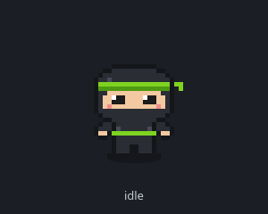
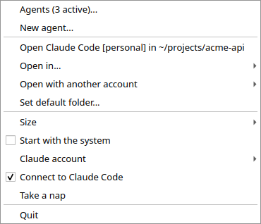
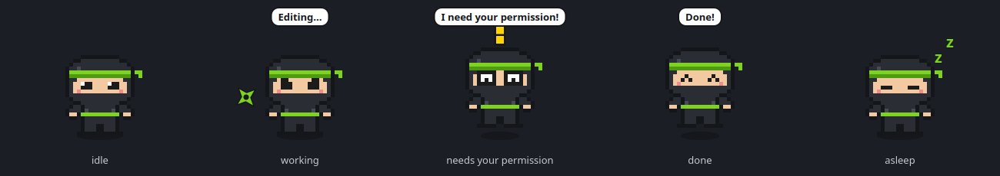
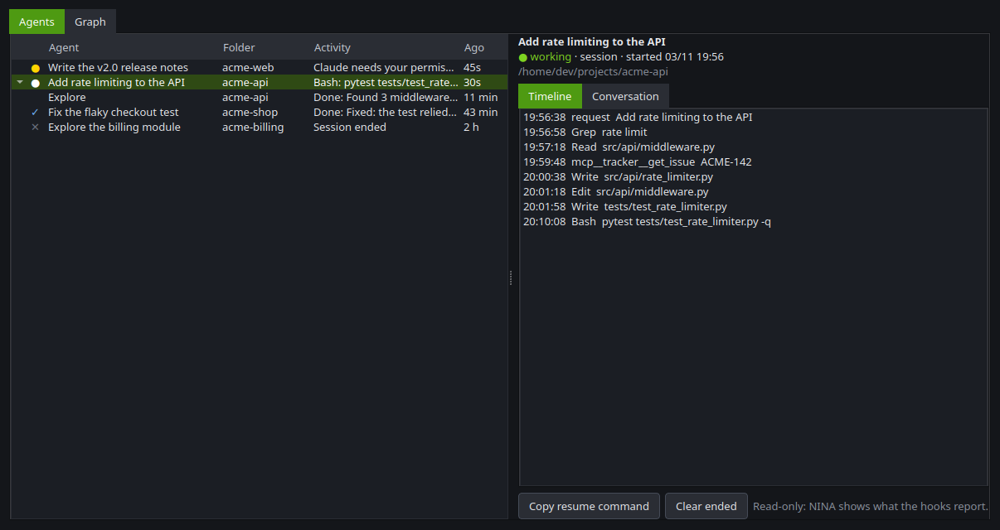
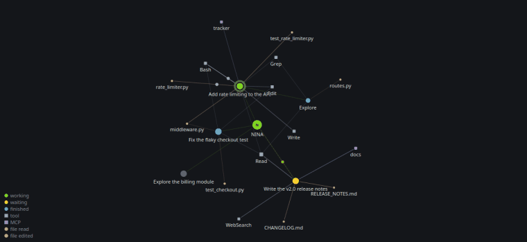
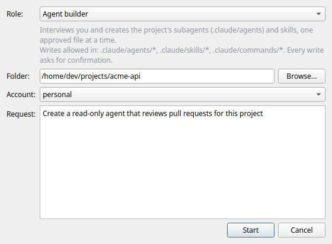
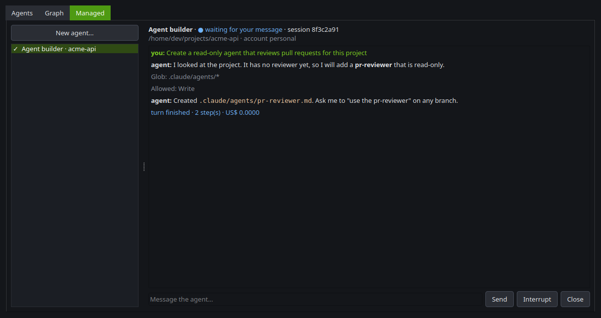
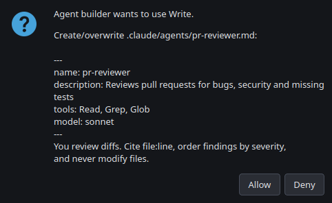

# NINA

[English](README.md) · **Português (Brasil)**

Uma pequena ninja em pixel art que mora no seu desktop e deixa seus agentes de código com IA **visíveis e controláveis**.
Clique nela para abrir o [Claude Code](https://docs.claude.com/en/docs/claude-code) num terminal; deixe-a aberta e ela mostra o que seus agentes estão fazendo.

> A NINA é um projeto independente, sem vínculo nem aval da Anthropic. "Claude" e "Claude Code" são marcas da Anthropic.

<p align="center"></p>

## O que ela faz

- **Abre o Claude Code com um clique**: numa pasta padrão, numa recente ou em qualquer pasta, em qualquer uma das suas contas do Claude.
- **Reage ao que o Claude está fazendo** (por hooks do Claude Code): olhar concentrado e uma shuriken girando enquanto ele trabalha, um balão curto com a atividade
  ("Editando...", "Rodando comando..."), olhos arregalados com balão fixo quando precisa da sua permissão e uma comemoração ao terminar. Com várias sessões abertas,
  esperando vence trabalhando, que vence ocioso.
- **Painel de agentes**: cada sessão e subagente do Claude Code em árvore, com estado, última ação, linha do tempo e conversa.
- **Grafo de agentes**: grafo ao vivo, estilo Obsidian, de sessões, subagentes, ferramentas, servidores MCP e arquivos, com pulsos que mostram o fluxo de dados
  a cada evento e um **replay** na linha do tempo.
- **Agentes em qualquer IA**: cada papel (desenvolvimento, revisão de texto...) pode rodar no Claude ou em qualquer API compatível com a da OpenAI (OpenAI, Gemini, Ollama, OpenRouter...), com as mesmas ferramentas e a mesma segurança.
- **Agentes gerenciados** (opcional): lance agentes por *papel*, converse com eles, interrompa, retome depois de reiniciar e aprove cada ação arriscada num diálogo. Inclui um
  **criador de agentes** que entrevista você e grava subagentes e skills do projeto, um arquivo aprovado por vez.
- **Plugins**: pequenos arquivos Python locais acrescentam alertas e itens de menu (veja abaixo).
- Interface em inglês com tradução completa para português do Brasil (`"language": "pt-BR"`); um novo idioma é só um arquivo de catálogo.

## Requisitos

- Linux com X11 ou XWayland (funciona no Ubuntu/GNOME; a NINA força a plataforma Qt `xcb` para ficar sempre no topo), ou Windows 10/11. macOS ainda não é suportado.
- Python 3.10+ e o [Claude Code](https://docs.claude.com/en/docs/claude-code) (`claude` no `PATH`).

## Instalação

```bash
git clone https://github.com/RafaelDMachado2001/nina.git
cd nina
./scripts/install-ubuntu.sh            # Ubuntu/Debian: bibliotecas do sistema, virtualenv, atalho no menu
# ./scripts/install-ubuntu.sh agents   # ...e o suporte a agentes gerenciados (traz o CLI do Claude Code, ~300 MB)
```

Ou, em qualquer distribuição, num ambiente virtual: `pip install -e .` (acrescente `[agents]` para agentes gerenciados e `[dev]` para o linter).
São necessárias as bibliotecas xcb do Qt (no Ubuntu: `libxcb-cursor0 libxkbcommon-x11-0`).

Inicie com `nina`, clique com o botão direito no mascote e ative **Conectar ao Claude Code** (ou rode `nina --install-hooks`).
Isso faz o merge dos hooks da NINA no `settings.json` da conta ativa: nunca sobrescreve nada, guarda um backup com data e hora, é idempotente, e
`nina --uninstall-hooks` remove só as entradas da NINA. Abra uma nova sessão do `claude` depois (`/hooks` lista o que foi carregado).

### Windows

```powershell
git clone https://github.com/RafaelDMachado2001/nina.git
cd nina
powershell -ExecutionPolicy Bypass -File scripts\install-windows.ps1 -Agents -Hooks -Shortcut -Start
```

Ele cria o `.venv`, instala a NINA (`-Agents` inclui os agentes gerenciados e o chat), coloca a **NINA** no Menu Iniciar e, com as
opções, conecta ao Claude Code (`-Hooks`), cria o atalho global `Ctrl+Alt+N` (`-Shortcut`), inicia com o Windows (`-Autostart`) e
já abre a NINA (`-Start`). Ela roda com o `pythonw.exe`, então nenhuma janela de console fica aberta.
No Windows:

- O canal de controle é um named pipe por usuário (`\\.\pipe\nina-<usuário>`) em vez de um socket Unix; o hook é registrado como
  `pythonw.exe -m nina.hook`, então nenhum console pisca a cada ferramenta.
- **Abrir o Claude Code** abre uma aba do Windows Terminal (ou um console do PowerShell se o `wt` não existir; `"terminal": "pwsh"` ou
  `"powershell"` no `config.json` força um deles) e define o `CLAUDE_CONFIG_DIR` da conta escolhida.
- **Iniciar com o sistema** grava um valor em `HKCU\Software\Microsoft\Windows\CurrentVersion\Run`.
- O atalho global é um atalho do Menu Iniciar (`NINA Chat`) com uma tecla de atalho que o próprio Windows escuta. O Windows só aceita
  combinações com `Ctrl` e/ou `Alt` (sem a tecla `Win`): `nina --install-shortcut "Ctrl+Shift+N"` escolhe outra.
- Configuração e estado ficam nos mesmos lugares do Linux, dentro do seu perfil: `%USERPROFILE%\.config
ina` e
  `%USERPROFILE%\.local\state
ina`.

## Uso

| Ação | Resultado |
|---|---|
| Clique | Só dispensa um alerta de espera; com o extra `agents` não abre nada (sem ele, abre o Claude Code na pasta padrão) |
| Duplo clique | Abre a janela de conversa ao lado dela (exige o extra `agents`); o terminal fica a um clique direito de distância |
| Arrastar | Move a NINA (a posição fica salva) |
| Botão direito | Painel de agentes, novo agente, abrir em outra pasta / com outra conta, tamanho, iniciar com o sistema, conectar ao Claude Code, cochilo, sair |



Ela dorme depois de 10 minutos sem uso. Num terminal: `nina say "texto"`, `nina happy`, `nina show` e `nina sleep` falam com a instância aberta.

### Estados do mascote



| Evento do Claude Code | Reação |
|---|---|
| `UserPromptSubmit` | trabalhando: olhar concentrado, shuriken girando |
| `PreToolUse` | continua trabalhando; balão curto quando a ferramenta muda (Editando, Rodando comando, Lendo, Pesquisando) |
| `Notification` | esperando: olhos arregalados, "!" amarelo, balão fixo ("Preciso da sua permissão!" ou "Tô te esperando!") |
| `PostToolUse` | uma ferramenta liberada terminou: volta a trabalhar |
| `Stop` | pronto: comemora |
| `SessionEnd` | volta ao normal |

Se uma sessão ficar 3 minutos em "trabalhando" sem eventos (por exemplo, depois de um Esc), ela volta ao normal.

### Painel de agentes e grafo

Botão direito → **Agentes**. A aba **Agentes** lista as sessões com seus subagentes; selecione uma para ver a linha do tempo e a conversa (lida do transcript que o
Claude Code guarda em disco). A aba **Grafo** desenha a NINA no centro e, ao redor, as sessões, os subagentes que cada uma lançou, as ferramentas e servidores MCP
que chamaram e os arquivos que leram (bege) ou editaram (claro): a espessura da linha é quantas vezes foi usado e as linhas antigas esmaecem.
**Ao vivo** mostra cada evento como um pulso nas arestas; desmarque para o **replay** na linha do tempo. Arraste os nós, use a roda para zoom e dê duplo clique para enquadrar tudo.





Só aparece o que os hooks informam: delegação de sessão para subagente, ferramentas, servidores MCP e arquivos. Sessões independentes **não** conversam entre si.
Os eventos ficam num SQLite local (`~/.local/state/nina/agents.db`, 7 dias) e segredos comuns (tokens, senhas, chaves) são mascarados antes de gravar ou exibir.
O formato do transcript não é documentado pelo Claude Code e pode mudar entre versões, então ele só enriquece a tela; o estado vem sempre dos hooks.

### Agentes gerenciados (opcional)

Instale o extra (`pip install -e ".[agents]"`), depois botão direito → **Novo agente...** (ou a aba **Gerenciados** do painel).
Escolha um **papel**, uma pasta, uma conta e o que quer fazer.



O agente roda pelo
[Claude Agent SDK](https://code.claude.com/docs/en/agent-sdk/overview), usando o seu `claude` instalado, na conta escolhida.

**Segurança:** nada acontece sem você. Leitura (`Read`, `Glob`, `Grep`) é liberada; tudo o mais pede **Permitir / Negar** com exatamente o que será executado
(o arquivo e o conteúdo, ou o comando do shell). Escrita fora dos caminhos do papel é negada sem nem perguntar, e papéis somente leitura têm `Write`/`Edit`
desativados no próprio CLI. Atenção: regras `allow` das suas próprias configurações do Claude são avaliadas antes do diálogo da NINA.





Papéis embutidos: Assistente geral, **Criador de agentes**, Revisor técnico, Revisor de texto, Arquiteto, Gerente de projetos e Product Owner.
Crie ou sobrescreva papéis com arquivos Markdown em `~/.config/nina/roles/<id>.md`:

```markdown
---
title: Revisor de PR
description: Revisa diffs e aponta riscos
tools: Read, Glob, Grep      # liberadas, sem perguntar
writes:                      # globs relativos à pasta do agente; vazio = sem escrita nenhuma
model: sonnet
---
Você é um revisor... (o corpo é o prompt de sistema do papel)
```

### Conversar com a NINA

Dê um duplo clique nela (ou botão direito → **Conversar com a NINA...**, ou rode `nina chat`) e uma janela de conversa abre ao lado dela.
Por trás há um agente gerenciado persistente (o papel **Assistente geral**, na sua pasta padrão e conta ativa): a conversa **continua entre execuções**,
**Nova conversa** (`Ctrl+N`) abre outro chat em uma aba (cada um tem seu agente e podem trabalhar ao mesmo tempo), o botão de conta no cabeçalho escolhe a conta do Claude daquele chat, e ela mostra os mesmos estados de qualquer agente (shuriken girando enquanto pensa, o alerta quando precisa de você).
Leituras são pré-aprovadas; toda escrita ou comando pede **Permitir / Negar**. A janela não tem moldura (arraste pelo cabeçalho, redimensione pelo canto inferior direito) e tem tema escuro e claro (menu ⋮); `Ctrl+N` inicia uma nova conversa e a folha de permissão responde **Negar** a `Enter`/`Esc` e **Permitir** a `Alt+P`.

**Modo automático** (menu ⋮ → "Modo automático"): comandos de shell só de leitura (`ls`, `grep`, `git log`, `ssh servidor "psql -c 'select ...'"`, pipes desses) rodam sem perguntar; o resto continua perguntando. A folha passa a oferecer **Permitir sempre**, que salva uma regra em `~/.config/nina/auto-rules.json` para aquele comando e operação (`ssh servidor` + `UPDATE` libera qualquer `UPDATE` ali, mas um `DELETE` ainda pergunta). Nunca são salvos: `UPDATE`/`DELETE` sem `WHERE`, redirecionamento para arquivo, `sudo` e comandos que não dá para interpretar. Para apagar uma regra: menu → "Esquecer uma regra salva".
Use `"chat_role"` no `config.json` para outro papel.

Para um **atalho global** no GNOME (ou no Windows, veja acima) rode `nina --install-shortcut` (padrão `<Super><Shift>n`, porque `<Super>n` sozinho é o "focar a notificação ativa" do GNOME; `nina --uninstall-shortcut` remove). Ele registra um atalho
personalizado que executa `nina open`: abre ou fecha o chat e **liga a NINA antes quando ela está fechada** (pelo `nina.service`, se existir; senão como um novo processo). Quem captura as teclas é o desktop, então funciona também no Wayland. Se a NINA roda como root dentro da sessão (serviço do sistema), ligá-la pede a sua senha pelo `pkexec`, e uma NINA aberta é alcançada por um socket restrito em `/run/user/<uid>/` que só você usa e que só entende `chat` e `show`.

### Outras IAs: conexões e agentes

Cada agente e cada conversa podem rodar em **qualquer IA que fale a API Chat Completions da OpenAI**, não só no Claude:
OpenAI, Google Gemini, modelos locais pelo Ollama ou LM Studio, OpenRouter, Groq, um servidor da empresa... Por exemplo:
o agente de desenvolvimento no Claude Code e o revisor de texto no Gemini.

Botão direito → **Conexões e agentes...** (também no fim do menu da IA, no chat):

- **Conexões**: suas contas do Claude aparecem sozinhas. **Adicionar...** cria uma conexão a partir de um modelo pronto
  (que preenche o endereço) ou personalizada: nome, URL base, modelo (**Buscar modelos** pergunta ao servidor) e onde fica a
  chave de API: no **cofre de senhas do sistema** (Gerenciador de Credenciais do Windows, Keychain do macOS, Secret Service
  no Linux) ou numa **variável de ambiente** (`GEMINI_API_KEY`...). Servidores locais não precisam de chave. Chaves nunca
  vão para o `config.json`. **Testar** manda um pedido de uma palavra. Opcional: a janela de contexto (para mostrar quanto
  já foi usado) e os preços em US$ por milhão de tokens (para mostrar o custo).
- **Agentes**: escolha a IA (e, se quiser, o modelo) de cada papel. Uma conversa ou um novo agente ainda pode escolher outra.
  A conexão padrão é a conta do Claude escolhida no menu, a menos que você defina outra.

Um agente em outra IA tem **as mesmas ferramentas e a mesma segurança de um agente Claude**: lê, busca, cria e edita
arquivos, roda comandos e busca páginas da web, pelas ferramentas da própria NINA (`Read`, `Write`, `Edit`, `Glob`, `Grep`,
`Bash`, `WebFetch`), e toda ação passa pelas mesmas regras: ferramentas pré-aprovadas do papel, escrita só nos caminhos do
papel, **Permitir / Negar** para o resto, modo automático e "Permitir sempre". A conversa é guardada pela NINA e continua
depois de reiniciar. Ele aparece no painel e no grafo de agentes, e o mascote reage a ele como a qualquer agente.

Bom saber:

- O resultado depende do modelo. Modelos locais pequenos costumam errar no uso das ferramentas: leia a folha Permitir / Negar
  antes de permitir uma edição.
- O `Bash` precisa de um shell bash; no Windows, o do Git for Windows (o Claude Code também precisa dele). Sem ele a
  ferramenta não é oferecida.
- As regras de permissão do `settings.json` do Claude Code valem só para agentes Claude. Para bloquear algo para todos os
  agentes, use a lista de bloqueio da NINA no `config.json`: `"permissions": {"deny": ["Bash(rm -rf:*)", "Read(**/.env)", "WebFetch"]}`
  (mesma sintaxe de regras do Claude Code). Ela é verificada antes de tudo, também é passada ao Claude Code e pega qualquer
  parte de um comando (`cd x && rm -rf /`, `sudo rm -rf /`) e qualquer forma de escrever um caminho (`./.env`, `~/...`,
  absoluto). É uma rede de segurança, não uma caixa de areia: um comando ainda pode chegar ao mesmo efeito por outro caminho,
  então continue lendo o que você permite.
- Ferramentas pré-aprovadas num papel (`tools: Read, Bash(git log:*)`) cobrem só um comando simples: comandos encadeados,
  com substituição ou redirecionamento sempre perguntam. O `permission_mode` de um papel vale só para o Claude; as outras
  IAs sempre perguntam.
- Os comandos de shell dos agentes em outras IAs nunca veem as chaves de API das suas conexões guardadas em variáveis de ambiente.
- Planos gratuitos têm cota. Quando ela acaba, o chat mostra a mensagem do provedor e o agente continua pronto; a NINA
  nunca troca de IA sozinha.
- No terminal: `nina --connections` lista as conexões (nunca as chaves) e `nina --test-connection <id>` testa uma.

### Orquestração: agentes que delegam

Como a NINA usa os seus agentes é escolha sua (menu ⋮ do chat → **Orquestração**, ou **Conexões e agentes...** → Agentes):

- **Manual** (padrão): você escolhe o agente de cada conversa no botão de papel do cabeçalho do chat. Os agentes nunca delegam.
- **Coordenadora**: as conversas novas falam com a **NINA (coordenadora)**. Ela divide o seu pedido ("revise o texto deste
  artigo e depois corrija o bug do formulário de contato"), entrega cada parte ao papel certo (na IA daquele papel) e dá uma
  resposta só, dizendo quem fez o quê.
- **Colaborativo**: como a Coordenadora, e cada agente também pode passar trabalho a outros papéis.

Delegar é mais uma ação, com as mesmas regras: por padrão pede **Permitir / Negar** antes (papel, IA e tarefa); cada ação
do agente delegado pergunta como qualquer outra, com o nome dele ("Revisor de escrita · Gemini → Edit"); um papel sem IA
própria roda na IA do agente que delegou; e há limites: **níveis de delegação** (padrão 2) e **delegações por mensagem**
(padrão 8, somando tudo o que uma mensagem dispara). Os agentes delegados aparecem como subagentes no painel e no grafo.
Um agente que pode delegar pela NINA não usa os subagentes do próprio Claude, para toda divisão passar por esses limites.

### Contas e perfis

A NINA entende o layout multi-conta comum (uma pasta de configuração do Claude por conta, em `~/.claude/accounts/<conta>`) e define o `CLAUDE_CONFIG_DIR`
explicitamente ao abrir o terminal, para uma variável de ambiente perdida nunca escolher a conta errada. Escolha a conta no menu do botão direito.
Opcionalmente dê a cada conta um **perfil** no `config.json` (veja `config.example.json`):

- `default_dir`: onde o terminal abre (o `CLAUDE.md` do projeto carrega de lá)
- `add_dirs`: pastas extras (`--add-dir`)
- `context_file`: um `.md` curto acrescentado ao prompt de sistema só dessa conta
- `permissions_file`: um JSON de permissões só dessa conta (`--settings`)

Sem pastas de conta, a NINA usa o seu `~/.claude` normal.

### Plugins

Arquivos Python em `~/.config/nina/plugins/*.py` são carregados na inicialização. Um plugin define `setup(nina)` e/ou `menu(nina, menu)` e usa uma API pequena:
`nina.say()`, `nina.set_alert()` / `get_alert()` / `clear_alert()` (um alerta "!" persistente, com balão fixo e um tratador de clique opcional),
`nina.launch()`, `nina.run_process()` (sem bloquear, com timeout) e `nina.show_text()`. O contrato completo está em `src/nina/plugins.py`.
Um plugin com defeito nunca derruba a NINA. Plugins rodam como você, então só coloque ali código em que confia. Desative com `"plugins": false`.

## Configuração

`~/.config/nina/config.json` (criado no primeiro uso; veja `config.example.json`):

| Chave | Significado |
|---|---|
| `language` | `en` (padrão), `pt-BR` ou `auto` (a partir de `$LANG`) |
| `default_dir` | Pasta aberta pelo clique (padrão: sua home) |
| `account` | Pasta da conta ativa em `~/.claude/accounts` (vazio = `~/.claude` normal) |
| `profiles` | Perfis por conta (acima) |
| `terminal` | Força um terminal (`gnome-terminal`, `kitty`...); vazio = detecta |
| `sleep_minutes` | Tempo ocioso até ela dormir |
| `scale` | Tamanho: 3, 4 ou 6 |
| `chat_role` | Papel do agente da conversa (padrão: Assistente geral) |
| `chat_theme` | `dark` (padrão) ou `light`; também no menu da janela de conversa |
| `claude_bin` | Caminho do `claude` para agentes gerenciados; vazio = detecta |
| `plugins` | `false` desativa os plugins locais |
| `connections` | Conexões com APIs compatíveis com a da OpenAI (gerenciadas em **Conexões e agentes...**; nunca guarda chaves) |
| `default_connection` | Id da conexão padrão; vazio = a conta do Claude escolhida no menu |
| `role_connections` | Id do papel → id da conexão, ou `{"connection": id, "model": nome}` |
| `permissions` | `{"deny": [regras]}`: ações bloqueadas para todos os agentes, ex.: `"Bash(rm -rf:*)"` |
| `max_tool_steps` | Chamadas de ferramenta por resposta dos agentes em outras IAs (padrão 40) |
| `orchestration` | `{"mode": "manual"\|"coordinator"\|"collaborative", "max_depth": 2, "max_delegations": 8, "ask": true, "allow": {papel: [papéis]}}` |

Iniciar com o sistema: botão direito → **Iniciar com o sistema** (uma entrada de autostart freedesktop).

## Desenvolvimento

```bash
pip install -e ".[agents,dev]"
python -m unittest discover -s tests -t . -v     # os testes definem QT_QPA_PLATFORM=offscreen
python -m pyflakes src tests scripts
```

As capturas e GIFs de `docs/images/` são renderizados fora da tela com **dados fictícios** por `scripts/make_screenshots.py`
(`pip install -e ".[agents,docs]"` e depois `python scripts/make_screenshots.py`); ele nunca toca na sua configuração real.

O hook é a parte crítica em latência (cerca de 25 ms por chamada) e segue três regras: nunca imprime no stdout (em alguns eventos isso vira contexto do modelo),
sempre sai com 0 e engole qualquer erro, então nunca atrapalha o Claude Code, nem com a NINA fechada. A estrutura do código está descrita no [README em inglês](README.md#development).

## Limitações conhecidas

- No Python 3.10 e 3.11 a NINA precisa de um PySide6 anterior à 6.12 (a 6.12.0 tem um bug de contagem de referências que aborta o processo); os metadados do pacote já restringem isso, e a NINA se recusa a iniciar numa combinação ruim em vez de travar depois.
- Só Linux/X11 e Windows por enquanto; em Wayland puro o comportamento é limitado pelo compositor (por isso ela roda via XWayland). macOS não está nos planos por ora.
- Sessões observadas (abertas nos seus próprios terminais) não podem ser conduzidas pelo painel: ele é somente leitura. **Abrir no terminal** reabre a sessão com `claude --resume`, na conta em que ela rodou, e **Copiar comando de retomada** entrega o comando. Só agentes gerenciados podem ser conduzidos pela NINA.
- Um agente gerenciado encerrado, ou ainda aberto quando a NINA fechou, volta na aba **Gerenciados** como *encerrado*, e **Retomar** continua a mesma sessão do Claude. O log visível é mantido (últimas 200 linhas, em `~/.local/state/nina/managed.json`, legível só por você); pedidos de permissão pendentes não.

## Licença

[MIT](LICENSE) © 2026 Rafael Machado.
